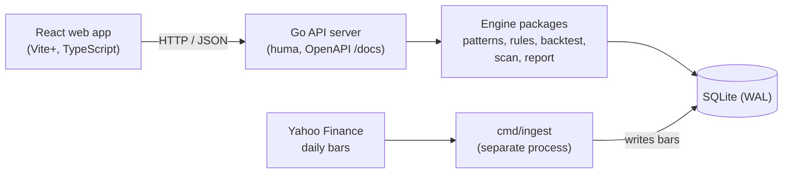

# Kanso

Kanso is a breakout scanner and backtester for NSE stocks. It finds stocks closing above a multi-year high, shows the evidence behind every verdict, and tests a rule over history with the fill and survivorship decisions spelled out next to the results.

It is a technical-analysis tool only. It reads end-of-day prices and tells you what a rule would have done. It does not trade.

**Live demo:** _coming soon_ (the public deploy is deferred; run it locally for now, see [Local setup](#local-setup), or run the demo container, see [Demo mode](#demo-mode)).

## What it does

- **Stock Report.** Pick a symbol and see every condition (new N-year high, volume surge, relative strength vs Nifty 50, not extended, old-high age) as Pass, Fail or Can't tell, with the numbers behind it. The breakout level is drawn on the chart and its age is always shown ("old high 5,425 set 2021-10-18"), so a continuation high is easy to tell from a base breakout.
- **Scanner.** Run a saved system or a one-pattern Quick Scan over a stock list. The default view shows fresh signals; a toggle shows everything that currently qualifies.
- **System Builder.** Combine required conditions and one "match any of these" group, set the exits, and backtest. Results lead with CAGR and maximum drawdown, each next to buy-and-hold Nifty 50.

## Stack

| Layer | Choice | Why |
|---|---|---|
| Engine and API | Go 1.27, `net/http` with [huma v2](https://huma.rocks/) (OpenAPI 3.1), `log/slog` | [ADR 0001](docs/adr/0001-go-engine-react-web.md), [ADR 0003](docs/adr/0003-openapi-contract-via-huma.md) |
| Storage | SQLite in WAL mode via pure-Go `modernc.org/sqlite`, sqlc queries, goose migrations, no cgo | [ADR 0002](docs/adr/0002-sqlite-not-duckdb.md) |
| Export | Parquet (output only: the oracle fixture) | [ADR 0002](docs/adr/0002-sqlite-not-duckdb.md) |
| Contract | OpenAPI generated from the Go handlers; [orval](https://orval.dev/) generates the typed TypeScript client and TanStack Query hooks | [ADR 0003](docs/adr/0003-openapi-contract-via-huma.md) |
| Numbers | float64 for prices and money, int64 for share quantities | [ADR 0004](docs/adr/0004-float64-simulator-not-ledger.md) |
| Web | React 19, TypeScript 7, Vite+ (`vp`: Vite, Vitest, Oxlint, Oxfmt), TanStack Router and Query, Tailwind v4, shadcn/ui | [ADR 0001](docs/adr/0001-go-engine-react-web.md) |
| Charts | [TradingView Lightweight Charts](https://www.tradingview.com/lightweight-charts/) for price and equity | |
| Ingest | A separate `cmd/ingest` process that writes to the same SQLite file | |

The API is documented at **`/docs`** on a running server (for example <http://127.0.0.1:8080/docs>), and the raw spec is at `/openapi.json`. The committed copy is [`api/openapi.json`](api/openapi.json).

## Architecture



The Go packages live in `internal/`:

- `market`: instruments, bars, weekly resampling, data gaps.
- `data`: the Yahoo source and the SQLite store.
- `patterns`: one type per condition, each returning Pass, Evaluable and typed evidence.
- `rules`: the rule tree, validation and the explanation of which conditions passed.
- `backtest`: signals, trade paths, costs, the portfolio simulation and metrics.
- `scan` and `report`: the Scanner and the Stock Report.
- `api`: the HTTP handlers and the OpenAPI contract.

The web app's types come from the OpenAPI spec, so the Go structs are the single source of truth. `make check-api` fails when the committed spec or the generated client is stale.

## Honesty decisions

A backtest is easy to make look good. These are the choices Kanso makes, and the honesty panel shows them next to every result.

- **Fills at the next day's open.** A signal on day t's close is bought at the open of day t+1, plus slippage (0.10% per side) and costs (0.20% per side). Nothing uses a bar before its close. A gap-up open still fills, and the share count is worked out at that fill price, not the signal close.
- **Stops fill at the worse price.** If a day's low reaches the stop, the exit is at the lower of the open and the stop, so a gap down through the stop fills at the open.
- **Survivorship bias is flagged.** Stock lists are today's index members. Stocks that left the index (DIVISLAB left the Nifty 50) or joined it because they rose (TRENT) skew the results, and every result says so.
- **History starts in 2007.** Yahoo's Nifty 50 history starts in September 2007. Relative strength and the benchmark can't be worked out before that, so backtests start at the later of the requested date and the benchmark's start, and the actual first date is shown.
- **The gap rule.** More than 5 consecutive missing trading days in a stock (measured against the Nifty 50's trading days) marks the bars across the gap as not evaluable. A condition that can't be evaluated is shown as "Can't tell", with the reason, never as a pass or a fail.
- **Re-entry needs the rule to turn false, then true.** A signal fires only on the bar where the entry rule becomes true after being evaluable and false the bar before. After an exit, there is no re-entry while the price is still above the level; a fresh breakout is needed. A bar after a data gap, or the first bar with enough history, never counts as fresh.
- **The data's date, not the calendar's.** Every result says "as of" the latest bar in the data. Yahoo can lag a day behind the NSE close.
- **Variations are counted.** The builder counts the distinct parameter sets you have backtested and warns about overfitting past 10 (lands with issue #10, along with the full honesty panel).

The full definitions are in the [design spec](docs/superpowers/specs/2026-11-19-kanso-breakout-scanner-design.md) (§5) and the terms in [`GLOSSARY.md`](GLOSSARY.md).

## What V0 taught us

Before writing any V1 code, three days went into existing tools (TradingView, Chartink, vectorbt, PKScreener, stock-pattern, eod2) to see the goal and find the traps. The notes are in [`docs/v0/reference-results.md`](docs/v0/reference-results.md). The main lessons:

- **Exits and risk matter more than entry filters.** On today's Nifty 50 from 2007, removing the volume, relative-strength and not-extended filters changed CAGR by under 1% a year. The robust finding was drawdown: about −27% for the system against −60% for buy-and-hold, mostly in 2008.
- **Most "new 3-year highs" are continuation highs.** Requiring the old high to be at least a year old gave the best trades, but only 38 in 19 years. So it is an optional filter, and the level's age is always shown.
- **Tools hide their assumptions.** TradingView silently skipped a real trade when the next-day open gapped up past 100% sizing. vectorbt checked stops on the close unless given open, high and low. A pattern detector that returned nothing gave no reason. Kanso shows the evidence and the reason for every verdict.
- **Volume has to be split-adjusted too.** eod2's unadjusted volume showed a fake 6× surge on BAJFINANCE's 2025 split and bonus. Yahoo's adjusted volume is right, so V1 uses Yahoo.

Those verified breakouts are now tests (see [Tests](#tests)).

## The oracle: vectorbt

[vectorbt](https://vectorbt.dev/) is the independent reference for the Go backtester. A dev-only Python tool in `tools/vbt-benchmark/` reads a frozen Parquet fixture exported from the SQLite store (`testdata/benchmark/bars.parquet`, about 10 Nifty 50 stocks plus `^NSEI`) and writes the expected signals and trades for a few benchmark systems. Those files are committed, and the Go test `TestBenchmarkAgainstVectorbt` compares Kanso against them, so the Go tests never need Python. Signal and entry dates must match exactly. Gapped stops (Kanso fills at the open, vectorbt at the stop) are listed as allowed differences. Where the two disagree on something the spec defines, the spec wins.

To regenerate the golden files after a deliberate change:

```sh
KANSO_DB=kanso.db make benchmark   # needs uv; review the diff like any other change
```

_Status: the benchmark lands with issue #14; until then `make benchmark` prints "not implemented yet"._

## Data

Prices are daily, split-adjusted (not dividend-adjusted) bars from **Yahoo Finance**'s public chart endpoint for `SYMBOL.NS` and `^NSEI`. That endpoint is unofficial and can change or rate-limit, so ingest retries with backoff and fails per symbol rather than writing partial data. Charts use TradingView Lightweight Charts, with its attribution kept on.

Kanso is a **non-commercial portfolio project**. The data belongs to its providers, there is no bulk-download endpoint, and nothing here is investment advice.

## Local setup

You need Go 1.27, Node 26 and pnpm.

```sh
# 1. Ingest a stock list and the Nifty 50 benchmark from Yahoo (a few minutes).
#    The constituents CSV comes from niftyindices.com (for example ind_nifty50list.csv).
go run ./cmd/ingest -db kanso.db -universe NIFTY50 -constituents ind_nifty50list.csv

# 2. Build the web app and embed it in the server binary (bin/server, bin/ingest),
#    then serve the API and the app on http://127.0.0.1:8080.
make run DB=kanso.db
```

The server listens on localhost only by default, because saved systems are writable without authentication. Use `-addr` to pick another address. `make build` copies `web/dist` into `internal/webui/dist`, which the binary embeds; `-web web/dist` serves a directory instead.

For web development, run the server as above and `cd web && pnpm install && pnpm dev`; Vite proxies `/api` and `/docs` to port 8080.

## Demo mode

The public demo is the same binary started with `-demo`:

- The database opens read-only. `POST`, `PUT` and `DELETE /api/systems` return 403, so the server stores nothing.
- The web app notices the first 403 and from then on keeps the visitor's saved systems in the browser's localStorage (or in memory, if storage is blocked). The variation count is already kept there.
- Backtest, scan, Quick Scan, Stock Report and bars share a per-IP limit of 60 requests a minute (`-rate-limit`). The client IP is the first `X-Forwarded-For` hop, else the connection's address. Over the limit, the answer is a 429 problem with `Retry-After`.
- `/api/bars` serves at most 5,000 bars per request, so the data can't be bulk-downloaded.
- Every request is logged as one JSON line (method, path, status, IP, duration).

To build and run the demo container locally:

```sh
make demo-snapshot              # Nifty 50 (deploy/nifty50.csv) plus ^NSEI from Yahoo into deploy/demo.db
docker build -t kanso .
docker run --rm -p 8080:8080 kanso
```

`make demo-snapshot` vacuums the database into one rollback-journal file, which opens read-only without the `-shm` file that WAL needs. The Dockerfile has three stages: Node 26 and pnpm build the web app, Go builds a static binary (`CGO_ENABLED=0`) with the app embedded, and a distroless static image runs it as a non-root user with `-demo -addr :${PORT}` (the server expands `${PORT}` itself, since the image has no shell).

### Deploying

The image runs on any container host that sets `PORT`. For Cloud Run (spec §6.4), keep **one instance**, so the in-memory rate limit holds:

```sh
# Once: an Artifact Registry repository in your project.
gcloud artifacts repositories create kanso --repository-format docker --location asia-south1
gcloud auth configure-docker asia-south1-docker.pkg.dev

# Each deploy: build locally (deploy/demo.db is gitignored, so a source build wouldn't see it).
IMAGE=asia-south1-docker.pkg.dev/$PROJECT_ID/kanso/kanso
make demo-snapshot
docker build --platform linux/amd64 -t $IMAGE .
docker push $IMAGE
gcloud run deploy kanso --image $IMAGE --region asia-south1 \
  --max-instances 1 --memory 512Mi --allow-unauthenticated
```

The CI deploy (Workload Identity Federation, Artifact Registry) is deferred until the public demo is wanted.

## Nightly ingest

Ingest is its own process, so it can write while the server reads (SQLite WAL). For personal use it runs from launchd on weekdays at 18:30 IST, after the NSE close, and again at 08:00 IST the next morning only if some instruments are still behind the benchmark, because Yahoo can lag a day. Each run records every instrument's latest bar date and prints "data as of <date>; N instruments behind". After a split or bonus, Yahoo rescales the whole history, so the update re-fetches that symbol in full.

```sh
# Fetch each symbol from its last stored date minus 10 days. A split in that window,
# or a stored close that moved more than 0.5%, re-fetches the symbol's full history.
go run ./cmd/ingest -db kanso.db -universe NIFTY50 -constituents ind_nifty50list.csv -update
# The morning run: does nothing unless the data is behind.
go run ./cmd/ingest -db kanso.db -universe NIFTY50 -constituents ind_nifty50list.csv -update -only-if-behind
```

Example launchd jobs for both runs are in [`deploy/launchd/`](deploy/launchd/); edit their paths before loading them. A full fetch (a backfill without `-update`, or a re-fetch after a split) starts at `-from` or the symbol's first stored bar, whichever is earlier, and replaces its history in one step: re-running with a later `-from` keeps the older bars and puts them on Yahoo's current adjustment.

## Tests

```sh
make test        # Go tests: no network, Python or database needed
make test-web    # web unit tests (Vitest)
make check-api   # the committed OpenAPI spec and TypeScript client are fresh
```

The Go tests include golden tests per pattern, a no-look-ahead property test (signals on data cut at t match signals on the full data up to t), fill tests, and resampling tests across holidays and short weeks.

**Real-data tests** check the engine against the NSE breakouts verified by eye in V0: five breakouts in [`testdata/realdata/breakouts.csv`](testdata/realdata/breakouts.csv) (level within 0.5%, level date, volume ratio within 10%, volume pass or fail), NAVINFLUOR's continuation high failing the one-year old-high filter, and BAJFINANCE's split-adjusted volume. They skip unless `KANSO_DB` points at an ingested database, which they open read-only. Three of the symbols (DIVISLAB, HEROMOTOCO, NAVINFLUOR) are not in today's Nifty 50, so ingest them first:

```sh
go run ./cmd/ingest -db kanso.db -universe REALDATA -constituents testdata/realdata/symbols.csv
KANSO_DB=$PWD/kanso.db go test ./internal/report -run RealData -v
```

## License

[MIT](LICENSE). The market data is not covered by this license.
